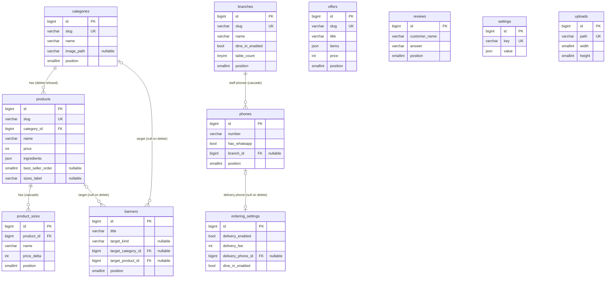

# Database — restaurant-api

> The tables, columns, keys and delete rules, and why. Decisions 1.1–1.8 agreed 2026-11-11 (see [BACKEND_PLAN.md](BACKEND_PLAN.md) §6).
> The JSON the API sends is in `../restaurant-template/src/types/` and the contract; this file is how it's stored. **Status:** approved 2026-11-11 and implemented (migrations, models, factories; rules tested in `tests/Feature/Database/SchemaRulesTest.php`).

## 1. Principles

- **MySQL** (local 9.2, CI 8.0, Hostinger MySQL or MariaDB): nothing version-specific. `utf8mb4` / `utf8mb4_unicode_ci` (Arabic and emoji).
- **Internal ids are auto-increment.** Categories, products, offers and branches also have a unique **`slug`**, which the API sends as `id`. Foreign keys always use the internal id, so editing a slug changes nothing else (decision 1.2).
- **Other records** (sizes, phones, banners, reviews) are sent with their internal id as a string (`"12"`), as the contract says.
- **Order** is a `position` column (`order` is an SQL reserved word), 1…n with no gaps, kept by the move actions inside a transaction. **No unique index** on positions, so a move can swap two rows without a temporary value (decision 1.3).
- **Images are stored as a path** on the `public` disk (`uploads/3f9c….webp`); the Resource builds the full URL. Changing host (staging, production, the domain) breaks no stored data (decision 1.6).
- **Enums** (`image_style`, `target_kind`) are `VARCHAR` columns cast to PHP backed enums, not MySQL `ENUM`: adding a value needs no `ALTER`.
- **Lengths:** the real limits are enforced by the FormRequests (ported from `validation.ts`). Columns are a bit wider: texts with `**marks**` are stored with their stars, and the limits count without them.
- **Small data** (tens of rows per table): no indexes beyond primary keys, uniques and foreign keys.
- `?` below = nullable. Every content table has `created_at` / `updated_at` unless said otherwise.

## 2. Diagram

`settings`, `uploads`, `users`, `personal_access_tokens`, `cache` and `cache_locks` have no relations.

## 3. Tables

### Menu

**`categories`**

| Column | Type | Notes |
|---|---|---|
| `slug` | varchar(80), unique | API `id`; menu anchor `#category-<slug>` |
| `name` | varchar(50) | limit 24 |
| `image_path` | varchar(255)? | `PATCH { "image": null }` sets it to null |
| `position` | smallint unsigned | API `order` |

**`products`**

| Column | Type | Notes |
|---|---|---|
| `slug` | varchar(80), unique | API `id`, `/menu/<slug>`. Also unique against `offers.slug` (validation rule, decision 1.2) |
| `category_id` | FK → `categories`, **restrict on delete** | The action answers `409` first; the key is the backstop |
| `name` | varchar(80) | limit 40 |
| `description` | varchar(255) | limit 160 |
| `ingredients` | json | list of strings, ≤ 10 × 30 |
| `price` | int unsigned | SYP |
| `image_path` | varchar(255)? | |
| `image_style` | varchar(10)? | `cutout` \| `photo`; null = `cutout` (left out of the JSON) |
| `is_available` | boolean | |
| `is_best_seller` | boolean | needs an image (`422` on `isBestSeller`) |
| `best_seller_order` | smallint unsigned? | 1…n among best sellers, null otherwise |
| `sizes_label` | varchar(50)? | name of the size group (e.g. `الحجم`); null when the product has no sizes |

Products have no move endpoint: inside a category they are listed by `id` (creation order).

**`product_sizes`** (decision 1.4, no timestamps)

| Column | Type | Notes |
|---|---|---|
| `product_id` | FK → `products`, cascade on delete | |
| `name` | varchar(50) | limit 24 |
| `short_name` | varchar(20)? | limit 10 |
| `price_delta` | int (signed) | added to the base price; a smaller size can be cheaper |
| `position` | smallint unsigned | order in the list |

The Resource rebuilds the frontend shape: `optionGroups: [{ id: "size", name: sizes_label, required: true, maxSelect: 1, options: [{ id: "<product_sizes.id>", name, shortName?, priceDelta }] }]`, or leaves `optionGroups` out when there are no sizes. Saving syncs by id (API-CONTRACT §4.1): sent id → update, `""` → create, missing → delete. Cart lines keep the size id.

### Content

**`offers`**

| Column | Type | Notes |
|---|---|---|
| `slug` | varchar(80), unique | API `id`; unique against `products.slug` too |
| `title` | varchar(60) | limit 30 |
| `items` | json | ≤ 6 × 40 |
| `free_item` | varchar(80) | limit 40 |
| `price` | int unsigned | |
| `image_path` | varchar(255) | required |
| `image_style` | varchar(10)? | |
| `badge` | varchar(40)? | limit 20 |
| `is_active` | boolean | |
| `position` | smallint unsigned | not in the JSON: the list order |

**`banners`**

| Column | Type | Notes |
|---|---|---|
| `eyebrow` | varchar(50)? | limit 24 |
| `title` | varchar(60) | ≤ 2 lines × 22, the line break is kept |
| `image_path` | varchar(255) | |
| `image_alt` | varchar(120) | |
| `action_label` | varchar(40)? | null = no button |
| `target_kind` | varchar(10)? | `offers` \| `category` \| `product` |
| `target_category_id` | FK → `categories`?, **null on delete** | set when `target_kind = category` |
| `target_product_id` | FK → `products`?, **null on delete** | set when `target_kind = product` |
| `is_active` | boolean | |
| `position` | smallint unsigned | |

When the target is deleted, its key becomes null: the public `GET /banners` drops the button (the slide stays), and the admin GET sends the target with an empty id (`productId: ""`) so the dashboard shows "target gone" (decision 1.5; to add to the contract).

**`reviews`**

| Column | Type | Notes |
|---|---|---|
| `customer_name` | varchar(40) | limit 20 |
| `question` | varchar(255)? | limit 120; null = the section's default question |
| `answer` | varchar(500) | limit 220 without `**` |
| `time` | varchar(20)? | display text, e.g. `9:41 م` |
| `is_visible` | boolean | |
| `position` | smallint unsigned | |

### Restaurant

**`branches`**

| Column | Type | Notes |
|---|---|---|
| `slug` | varchar(80), unique | API `id`. **`qanawat-road` and `al-mehwari` are printed in QR codes** |
| `name` | varchar(60) | limit 30 |
| `address` | varchar(160) | limit 80 |
| `map_url` | varchar(500)? | https |
| `dine_in_enabled` | boolean, default false | `ordering.dineIn.branches[].isEnabled` (decision 1.1) |
| `table_count` | tinyint unsigned, default 0 | 0–99, ≥ 1 when on |
| `position` | smallint unsigned | |

The dine-in settings live on the branch row, so deleting a branch deletes them with it. Site info saves `name` / `address` / `map_url`; ordering saves `dine_in_enabled` / `table_count`. Each save touches only its own columns.

**`phones`**

| Column | Type | Notes |
|---|---|---|
| `number` | varchar(20) | `+963` + 8–9 digits |
| `has_whatsapp` | boolean | |
| `branch_id` | FK → `branches`?, **cascade on delete** | set = the branch's floor staff phone, **never public** |
| `position` | smallint unsigned | the order sent; it decides which branch phone gets table orders (the first with WhatsApp) |

**`ordering_settings`** (exactly one row)

| Column | Type | Notes |
|---|---|---|
| `delivery_enabled` | boolean | |
| `delivery_fee` | int unsigned | |
| `delivery_phone_id` | FK → `phones`?, **null on delete** | While delivery is on, the site-info save refuses (`409`) before its phone can go. Null → the admin GET sends `phoneId: ""` |
| `dine_in_enabled` | boolean | |
| `greeting` | varchar(255) | limit 120, placeholders `{restaurant}` / `{name}` |
| `closing` | varchar(400) | limit 200 |
| `thank_you` | varchar(500) | limit 240 |

### Settings (JSON, decision 1.1)

**`settings`**: `key` varchar(40) unique, `value` json. One row per key, always read and saved whole, never queried inside. The JSON is in the API's camelCase shape, except images, which hold a **path**:

| `key` | `value` |
|---|---|
| `hero` | `{ badge?, headline, primaryActionLabel, secondaryActionLabel, features: [{ label, icon }] × 3 }` |
| `about` | `{ eyebrow, title, paragraphs: [1–4], closing, imagePath, imageAlt, badge? }` |
| `offers_section` | `{ isEnabled, eyebrow, title, menuCardImagePath? }` |
| `reviews_section` | `{ isEnabled, eyebrow, title, defaultQuestion }` |
| `site_info` | `{ tagline, openingHours?, openingHoursSchema?, socialLinks?: [{ platform, url }] }` (phones and branches are their own tables) |

The singleton rows (`settings` × 5, `ordering_settings` × 1) are created by the seeder (Phase 2). Every environment is seeded.

### Uploads

**`uploads`** (`created_at` only)

| Column | Type | Notes |
|---|---|---|
| `path` | varchar(255), unique | random file name on the `public` disk |
| `width`, `height` | smallint unsigned | returned by `POST /admin/uploads` |
| `size_bytes` | int unsigned | |

Daily job (`php artisan uploads:prune`): delete every upload older than 24 h whose path no image field uses (`categories`, `products`, `offers`, `banners`, and the `about` and `offers_section` settings). Replaced photos are caught by the same check. The list of image fields lives in `App\Support\ImageReferences`: **a new image field must be added there**, or its photos would be deleted after a day.

### Laravel's own tables (decision 1.8)

- **`users`**: `name`, `username` (unique), `password`. No email columns (login is `{ username, password }`).
- **`personal_access_tokens`**: Sanctum, as installed.
- **`cache`, `cache_locks`**: database cache and the login rate limiter.
- **Removed:** `password_reset_tokens`, `sessions`, `jobs`, `job_batches`, `failed_jobs`. `SESSION_DRIVER=array` (the API has no sessions) and `QUEUE_CONNECTION=sync` (no queue worker on Hostinger; the daily job runs from cron). Nothing is deployed, so the default migrations are edited in place.

## 4. Rules: where each one lives

| Rule (BACKEND_REQUIREMENTS §4) | Database | Application |
|---|---|---|
| Category with products can't be deleted | `restrict` on `products.category_id` | Action answers `409` with an Arabic message |
| Best sellers 1…n, no gaps; need a photo | | Product actions (renumber in a transaction); `422` on `isBestSeller` |
| Banner button whose target is gone | `null on delete` on both target keys | Public Resource drops the button |
| Branch deleted → its staff phones and dine-in settings | `cascade` on `phones.branch_id`; settings are branch columns | Site-info save (one transaction) |
| Delivery / a branch with tables left without WhatsApp | `null on delete` on `delivery_phone_id` (backstop) | Site-info save answers `409` |
| What's on in ordering needs a WhatsApp number | | Ordering save (`422`) |
| Product and offer slugs never collide | unique per table | Validation rule checking both tables |
| Slugs stable, branch slugs kept | unique | Never regenerated on save; seeder keeps the mock slugs |
| Category names unique; size names unique inside a product | | Validation (`في قسم بنفس الاسم`, `في حجم بنفس الاسم`) |
| Delivery goes to a **restaurant** phone (no `branch_id`) with WhatsApp | | Ordering save (`422` on `delivery.phoneId`) |
| A branch's table orders go to its **first** phone with WhatsApp | `phones.position` | `branchWhatsApp()` in the frontend: first in list order, so the site-info save keeps the order sent |
| New item goes last; no gaps after a move or a delete | `position` | Create: `max + 1`. Move: swap with the neighbour. Delete: renumber 1…n. All in a transaction |

## 5. Dashboard coverage

Every method of the dashboard's `DashboardRepository` (`src/lib/dashboard/repository.ts`, behaviour in `local-repository.ts`), what it calls and what it writes.

| Dashboard method | Endpoint | Writes |
|---|---|---|
| `updateProduct` (price, available, best seller) | `PATCH /admin/products/{id}` | `products`; best sellers renumbered |
| `createProduct` / `saveProduct` | `POST` / `PATCH /admin/products/{id}` | `products` + `product_sizes` (sync by id). The full save keeps `best_seller_order` |
| `deleteProduct` | `DELETE /admin/products/{id}` | `products` (sizes cascade, banner targets null); best sellers renumbered |
| `moveBestSeller` | `POST /admin/best-sellers/{id}/move` | `products.best_seller_order` |
| `createCategory` / `renameCategory` / `setCategoryImage` | `POST` / `PATCH /admin/categories/{id}` | `categories` (new = last) |
| `moveCategory` / `deleteCategory` | `POST …/move` / `DELETE` (`409` with products) | `categories.position` (renumbered) |
| `updateOffersSettings` | `PATCH /admin/offers-section` | `settings.offers_section` (only the fields sent) |
| `createOffer` / `saveOffer` / `setOfferActive` / `moveOffer` / `deleteOffer` | `/admin/offers…` | `offers` |
| `createBanner` / `saveBanner` / `setBannerActive` / `moveBanner` / `deleteBanner` | `/admin/banners…` | `banners` |
| `updateReviewsSettings` | `PATCH /admin/reviews-section` | `settings.reviews_section` |
| `createReview` / `saveReview` / `setReviewVisible` / `moveReview` / `deleteReview` | `/admin/reviews…` | `reviews` |
| `saveSiteInfo` | `PUT /admin/site-info` | `settings.site_info` + `branches` + `phones` (sync by id, one transaction; deleted branches take their staff phones and dine-in settings) |
| `saveOrdering` | `PUT /admin/ordering` | `ordering_settings` + `branches.dine_in_enabled` / `table_count` |
| `saveHero` / `saveAbout` | `PUT /admin/hero` / `PUT /admin/about` | `settings.hero` / `settings.about` |
| `uploadImage` | `POST /admin/uploads` | `uploads` + the file |
| `resetToOriginal` | none | Browser draft only (no-op with the API) |

Reads: the dashboard loads everything (hidden items included) through the admin GETs; the home tiles (`summary.ts`) are counts over that data, so nothing extra is stored. The ordering form lists **every** branch (from site info) with its dine-in setting, which is why those settings can be branch columns: the admin `GET /admin/ordering` returns `dineIn.branches` for all branches, in branch order.

## 6. For the contract (PR with the Phase 4 / 7 code)

- A banner target or the delivery phone that no longer exists is sent by the admin GET with an empty id (`""`).
- Sizes, phones, banners and reviews get new numeric ids at seeding (mock ids like `regular`, `phone-1`, `samer` don't survive). Already what the contract says; worth telling the frontend.
- **`PATCH /admin/products/{id}` also takes `bestSellerOrder`.** The contract lists only `price`, `isAvailable` and `isBestSeller`, but the dashboard's undo of «شيل من الأكثر مبيعاً» sends `bestSellerOrder` = old place − 0.5 (`undoBestSellerPlace` in `validation.ts`), so the product goes back to its place. The API accepts a number there, uses it only to sort, and stores 1…n (integers).
- `GET /admin/ordering` returns `dineIn.branches` for every branch, including ones never set (off, 0 tables). The dashboard's form already does the same merge.
